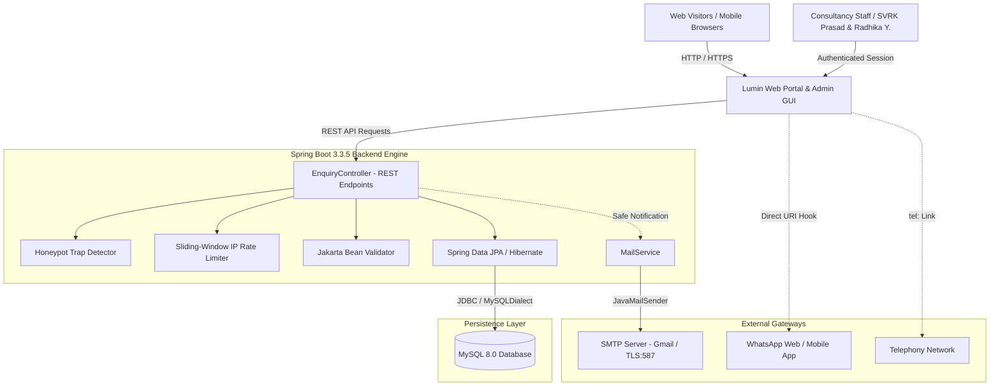
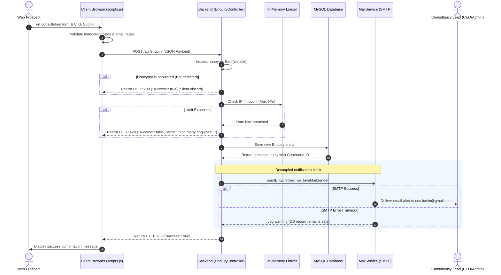
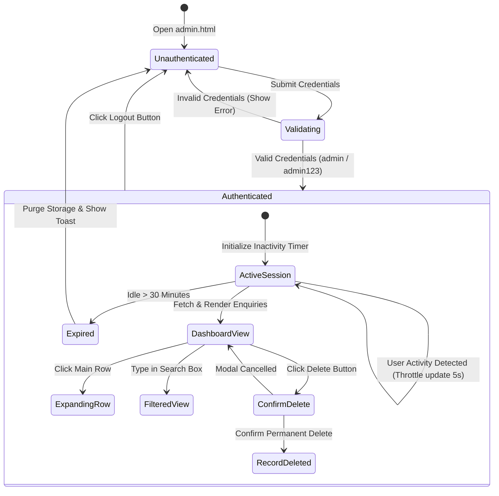
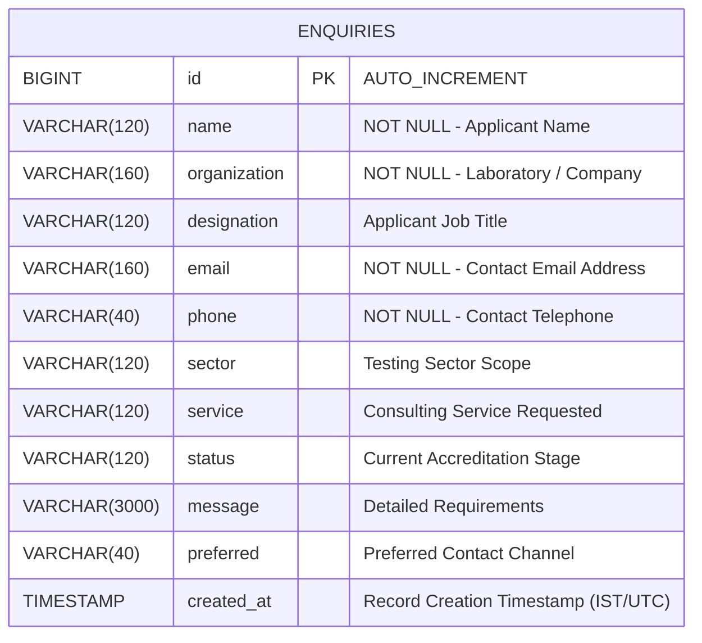

# Software Requirements Specification (SRS)
## Lumin Consultancy Web Portal & Laboratory Management Platform
**Document Version:** 1.0.0  
**Standard Compliance:** IEEE 830-1998 / ISO/IEC/IEEE 29148  
**Status:** Approved / Implemented  
**Date:** October 2026  
**System Name:** `lumin-site`  

---

## 1. Introduction

### 1.1 Purpose
This Software Requirements Specification (SRS) defines the functional, non-functional, interface, data, and security requirements for the **Lumin Consultancy Web Portal & Lead Management System (`lumin-site`)**. This document provides an authoritative blueprint for developers, quality assurance engineers, system administrators, and executive stakeholders involved in deploying, maintaining, and scaling the system.

### 1.2 Document Conventions
This specification conforms to standard IEEE 830 documentation structure:
- **`SHALL` / `MUST`**: Denotes an absolute, mandatory requirement.
- **`SHOULD` / `RECOMMENDED`**: Denotes a highly desired feature or best practice.
- **`MAY` / `OPTIONAL`**: Denotes an elective or discretionary capability.
- **Requirement Identifiers**: Formatted as `[REQ-TYPE-XXX]` (e.g., `[REQ-FUN-001]`).

### 1.3 Intended Audience and Reading Suggestions
- **Software Engineers & Architects**: Focus on Section 3 (Interfaces), Section 4 (Functional Requirements), Section 6 (Data & Schema), and Section 7 (System Architecture & Diagrams).
- **Quality Assurance & Testers**: Focus on Section 4 (Functional Requirements) and Section 8 (Verification & Traceability Matrix).
- **System Administrators & DevOps**: Focus on Section 2.4 (Operating Environment), Section 5 (Non-Functional Requirements), and Section 3.3 (Software Interfaces).
- **Business Executives & Consultancy Management**: Focus on Section 1.4 (Product Scope) and Section 2.2 (Product Functions).

### 1.4 Product Scope
**Lumin Consultancy** is an Indian quality and compliance consultancy firm founded in 2019 that guides commercial, industrial, environmental, food, and government testing laboratories towards **NABL Accreditation (ISO/IEC 17025:2017)** and statutory regulatory recognitions (FSSAI, EIC, BIS, APEDA, AGMARK, Tea Board, MOEF, and NABL-DGAQA Defence Quality Assurance).

The `lumin-site` platform delivers:
1. **Public Marketing & Information Portal**: Informational resources, portfolio showcase, service catalog, accreditation pathways, client testimonials, and laboratory training programs.
2. **Interactive Consultation Booking & Lead Capture System**: High-conversion enquiry capture with anti-bot honeypots, client-side validation, server-side data sanitization, and automated rate limiting.
3. **Notification & Mail Gateway**: High-priority dual-notification pipeline dispatching formatted email digests to consultancy executives via SMTP/TLS with asynchronous error isolation.
4. **Administrative Back-Office Portal**: Secured single-page management dashboard allowing authorized consultants to track, review, search, filter, and purge prospect records, with integrated 1-click WhatsApp, email, and phone outreach hooks.
5. **Interactive Media & Facility Gallery**: High-performance responsive visual portfolio with particle dynamics and responsive lightbox view.

### 1.5 References
- **ISO/IEC 17025:2017**: General requirements for the competence of testing and calibration laboratories.
- **NABL Standards & Policies**: NABL 100, NABL 131, NABL 160 guidelines.
- **IEEE Std 830-1998**: IEEE Recommended Practice for Software Requirements Specifications.
- **Spring Boot 3.3.5 Framework Reference Documentation**.
- **RFC 5321 / RFC 5322**: Simple Mail Transfer Protocol and Internet Message Format.

---

## 2. Overall Description

### 2.1 Product Perspective
The system functions as a self-contained, lightweight, cloud-deployable full-stack web application. It integrates a server-rendered / static asset frontend, a Spring Boot REST API application tier, an in-memory sliding-window security engine, a relational persistence tier (MySQL), and external communications gateways (SMTP Mail Server, WhatsApp Web protocol, Tel URI handler).



### 2.2 Product Functions
1. **Public Information Browsing**: Access to detailed descriptions of laboratory consulting services, company track record (7+ years, 200+ labs accredited, 100% satisfaction), and regulatory recognition pathways.
2. **Consultation Request Formulation**: Dynamic multi-field form enabling laboratories to define requirements, accreditation status, service interest, and preferred contact mode.
3. **Automated Submission Protection**: Rejection of automated bot spam without UI friction using honeypot detection; enforcement of a sliding rate limit (maximum 5 requests per hour per IP).
4. **Relational Record Persistence**: Automated storage of all genuine enquiries into MySQL with timestamping localized to Indian Standard Time (`Asia/Kolkata`).
5. **Decoupled SMTP Notification Delivery**: Formulation and dispatch of executive notification emails to `lumin.enquiry.to` with built-in fault tolerance (email failures do not abort database persistence).
6. **Administrative Session Management**: Secure credential authentication, session-based access control, active user tracking, and automated 30-minute inactivity session termination.
7. **Lead Triage & Real-Time Search**: Administrative data table with instant text search across all enquiry attributes (Name, Organization, Email, Phone, Sector, Service, Message).
8. **Direct Communication Triggers**: Instant one-click outreach mechanisms embedded in dashboard rows (prefilled WhatsApp chats, pre-addressed email replies, direct phone dialing).
9. **Controlled Data Retention**: Irreversible deletion of individual prospect records preceded by modal confirmation.
10. **Visual Portfolio Inspection**: Interactive masonry image gallery with responsive modal lightbox and keyboard controls.

### 2.3 User Classes and Characteristics
| User Class | Description | Technical Competence | Access Rights |
|---|---|---|---|
| **Public Visitor / Lab Representative** | Laboratory Directors, Quality Managers, Technical Officers seeking NABL accreditation or compliance support. | Basic web browsing ability. | Read public pages, submit consultation enquiry. |
| **Consultancy Administrator** | SVRK Prasad (CEO & Chief Consultant) and Radhika Yalamarthy (Management Head). | Moderate IT proficiency. | Authenticated access to `/admin.html`, review leads, export contacts, delete records. |
| **System Administrator / DevOps** | Technical staff deploying, configuring, monitoring, and maintaining application infrastructure. | High technical expertise in Java, Linux, Docker, MySQL, and DNS. | Full configuration, server environment variables, database maintenance, log review. |

### 2.4 Operating Environment
- **Server Platform**: Any Linux/Windows server running Java SE Runtime Environment (JRE) 17 or higher.
- **Framework & Containers**: Spring Boot 3.3.5 with embedded Apache Tomcat 10.1.
- **Database Engine**: MySQL 8.0+ (supported on local machines or cloud environments such as Railway, AWS RDS, DigitalOcean).
- **Client Web Browsers**: Modern evergreen browsers (Chrome 100+, Firefox 100+, Safari 15+, Edge 100+, Opera, Android Chrome, iOS Safari).
- **Network Ports**:
  - `8080` (Default HTTP, overridable via `${PORT}`).
  - `3306` (MySQL JDBC outbound/inbound).
  - `587` (SMTP TLS outbound to `smtp.gmail.com`).

### 2.5 Design and Implementation Constraints
1. **Java Version Constraint**: Source and target bytecode level MUST be Java 17.
2. **Stateless Backend Design**: The backend maintains no persistent HTTP sessions for clients; administrative authentication uses client-side session tokens with server-side endpoint protection.
3. **Database Independence Constraint**: Hibernate Object-Relational Mapping (ORM) and JPA standards MUST be used to ensure portability across SQL engines.
4. **Zero Heavy Frontend Frameworks**: The user interface is implemented in Vanilla HTML5, CSS3, and modern JavaScript (ES6+) without heavy compilation layers (React, Angular, Vue) to guarantee instant page loads and zero build overhead.
5. **Header Injection Prevention**: Email headers MUST be sanitized by stripping carriage returns and line feeds (`\r`, `\n`) from visitor inputs.
6. **Timezone Standardization**: Default application JVM timezone MUST be forced to `Asia/Kolkata` (IST) on startup.

### 2.6 Assumptions and Dependencies
- Valid SMTP credentials (e.g., Google Workspace or Gmail App Password) are provided via environment variables for live email delivery.
- Database connectivity to the MySQL host is continuous and stable.
- Client browsers have JavaScript enabled.

---

## 3. External Interface Requirements

### 3.1 User Interfaces

#### 3.1.1 Public Portal (`index.html`)
- **Header**: Sticky navigation with responsive logo branding, navigation anchors (`#home`, `#about`, `#services`, `#industries`, `#clients`, `#faq`, `gallery.html`, `#contact`), high-contrast "Book a Consultation" button, and mobile hamburger drawer.
- **Hero Section**: Canvas-based animated particle mesh (`particles.js`), high-impact value proposition ("Lighting Your Path to Accreditation Success"), pill badge ("Established 2019"), dual call-to-action buttons, and smooth scroll down arrow.
- **About Us & Pillars**: Three core pillars: **Clarity**, **Compliance**, and **Confidence**.
- **Company Insights Grid**: Key metric counters (7+ Years Excellence, 100% Client Satisfaction, 200+ Labs Guided, 8 Expert Consultants).
- **Services Catalog**: 8 specialized service cards covering NABL Accreditation, ISO/IEC 17025:2017 Implementation, Method Validation & Verification, Measurement Uncertainty, Audits & Gap Assessment, Lumin Academy Training, Regulatory Recognitions, and Ongoing Compliance.
- **Regulatory Recognition Grid**: Visual badge matrix featuring NABL-DGAQA, FSSAI, EIC, BIS, APEDA, AGMARK, Tea Board, and MOEF.
- **8-Step Approach Roadmap**: Sequential progression (Understand $\rightarrow$ Plan $\rightarrow$ Develop $\rightarrow$ Implement $\rightarrow$ Validate $\rightarrow$ Audit $\rightarrow$ Prepare $\rightarrow$ Improve).
- **Client Trust Showcase**: Client logos including Himalaya Wellness, Safran, Azista, RV Labs, Geomardy, TGVBRI, AP Department of Agriculture, B.S.Envitech, Aarvee Associates, Vimta Labs, PVNR Veterinary University, and Food Corporation of India (FCI).
- **Leadership Profiles**: Professional biography cards for SVRK Prasad (CEO) and Radhika Yalamarthy (Management Head) with direct phone and email links.
- **FAQ Accordion**: Native HTML5 `<details>` / `<summary>` accordions for instant technical FAQs without layout shifts.
- **Consultation Contact Form**: Responsive grid layout with field-level HTML5 and JavaScript validation, honeypot container, status alert box, and submission button.

#### 3.1.2 Media Gallery Interface (`gallery.html`)
- **Header & Hero**: Visual portfolio header with particle dynamics.
- **Masonry Grid**: Responsive image cards with zoom overlay icons and lazy loading.
- **Lightbox Modal**: Darkened overlay displaying full-resolution imagery with close button, backdrop click detection, and `Escape` key listener.

#### 3.1.3 Admin Management Dashboard (`admin.html`)
- **Split Login View**: Left column containing corporate branding, credential inputs (Username, Password with toggleable eye icon), and error alert; right column displaying testimonials, leadership cards, and contact metadata over an animated particle canvas.
- **Dashboard Header**: Live status indicator (green badge: "Admin Portal"), company logo, and logout trigger.
- **Lead Metrics & Controls**: Search bar with real-time substring filtering, manual refresh button with vector animation.
- **Enquiries Data Table**:
  - Expandable rows displaying Serial Number, Date (IST formatted), Name & Role, Organization, Contact (clickable email + WhatsApp icon), Sector badge, and Service requested.
  - Sub-row expansion card revealing full requirement notes, stage status, preferred contact mode, and action buttons.
  - Action buttons: "Reply via Email", "Reply on WhatsApp", "Call Client", and "Delete Record Permanently".
- **Confirmation Modal**: Custom modal dialog with warning icon and explicit "Delete Permanently" / "Cancel" buttons.
- **Toast Notifications**: Automatic non-intrusive notification popups (green for success, red for errors) with 4-second auto-dismissal.

### 3.2 Hardware Interfaces
- No direct physical hardware interfaces are required. Standard TCP/IP networking hardware applies.

### 3.3 Software Interfaces
| System Component | Interface Name | Protocol / Specification | Description |
|---|---|---|---|
| **Database Server** | MySQL Database | JDBC via `com.mysql.cj.jdbc.Driver` | Connection pool handling schema migration, reading, writing, and deleting enquiry records. |
| **Mail Gateway** | Spring Mail Sender | SMTP / TLS (Port 587) | Dispatches outbound plain-text structured email notifications to `ENQUIRY_TO`. |
| **Analytics Engine** | Google Analytics | JavaScript `gtag.js` | Emits custom telemetry events (`cta_click`, `enquiry_submitted`). |
| **WhatsApp Gateway** | WhatsApp Click-to-Chat | HTTPS (`https://wa.me/{phone}`) | Deep-links admin users directly into pre-populated WhatsApp conversations with prospects. |

### 3.4 Communications Interfaces
- **HTTP / HTTPS**: Standard web delivery over port 80/443 (configured via reverse proxy or directly via port 8080).
- **Content-Type**: `application/json` for REST APIs; `text/html`, `text/css`, `application/javascript` for static resources.
- **Encoding**: UTF-8 character encoding throughout all responses and database tables.

---

## 4. System Features & Functional Requirements



### 4.1 Feature: Public Information & Navigation
- **`[REQ-FUN-001]`**: The system SHALL provide a responsive navigation bar accessible across all device breakpoints with smooth scroll anchors.
- **`[REQ-FUN-002]`**: The mobile viewport (< 1024px) SHALL provide an accessible hamburger toggle with `aria-expanded` and `aria-controls` attributes, dismissible via external click, menu link click, or `Escape` key.
- **`[REQ-FUN-003]`**: The system SHALL display interactive particles in the hero section using WebGL/Canvas without blocking user scrolling or interaction.
- **`[REQ-FUN-004]`**: The system SHALL display the complete catalog of services, recognition scopes, client logos, and leadership profiles as verified in the company records.

### 4.2 Feature: Lead Capture & Enquiry Processing
- **`[REQ-FUN-010]`**: The system SHALL provide an enquiry form containing fields for Name, Organization, Designation, Email, Phone, Laboratory Sector, Service Required, Accreditation Status, Message, and Preferred Contact Method.
- **`[REQ-FUN-011]`**: The client frontend SHALL validate that Name, Organization, Email, and Phone are non-empty and that Email matches standard email syntax before transmitting requests.
- **`[REQ-FUN-012]`**: The server endpoint `POST /api/enquiry` SHALL enforce Jakarta Bean Validation:
  - `name`: Not blank, max 120 characters.
  - `organization`: Not blank, max 160 characters.
  - `designation`: Optional, max 120 characters.
  - `email`: Not blank, valid RFC format, max 160 characters.
  - `phone`: Not blank, max 40 characters.
  - `sector`, `service`, `status`, `preferred`: Max 120 characters each.
  - `message`: Max 3000 characters.

### 4.3 Feature: Anti-Spam & Security Protection
- **`[REQ-FUN-020]`**: The form SHALL embed an invisible honeypot field named `_honey` (mapped to `website` in the DTO) that is hidden from legitimate visitors via CSS.
- **`[REQ-FUN-021]`**: If the honeypot field contains any value upon submission, the server SHALL immediately return HTTP 200 `{"success": true}` while performing zero database writes and sending zero emails (silent drop).
- **`[REQ-FUN-022]`**: The server SHALL track submission timestamps per remote client IP in an in-memory queue.
- **`[REQ-FUN-023]`**: If more than 5 submissions originate from the same IP address within a 60-minute sliding window, the server SHALL reject the request with HTTP 429 (`TOO_MANY_REQUESTS`).
- **`[REQ-FUN-024]`**: The server SHALL sanitize all text inputs by stripping carriage returns (`\r`) and newline (`\n`) characters before injecting values into email headers to prevent SMTP header injection attacks.

### 4.4 Feature: Persistence & Email Notification Dispatch
- **`[REQ-FUN-030]`**: Each valid enquiry SHALL be persisted to the `enquiries` table in MySQL with an auto-generated surrogate primary key and an automated `createdAt` timestamp.
- **`[REQ-FUN-031]`**: Following successful database persistence, the system SHALL attempt to construct and transmit an email notification via `JavaMailSender` to the address configured in `lumin.enquiry.to` (default: `ceo.lumin@gmail.com`).
- **`[REQ-FUN-032]`**: The notification email's `Reply-To` header SHALL be set to the enquiry applicant's email address to enable direct reply threading.
- **`[REQ-FUN-033]`**: If the SMTP server is unreachable, credentials are unconfigured, or an SMTP timeout occurs, the system SHALL log a warning and return HTTP 200 to the client, guaranteeing that a lead is never lost due to external mail transport failure.

### 4.5 Feature: Administrative Portal & Session Lifecycle
- **`[REQ-FUN-040]`**: The administrative portal (`/admin.html`) SHALL present an authentication screen blocking dashboard access until valid credentials (`admin` / `admin123`) are supplied.
- **`[REQ-FUN-041]`**: The login interface SHALL support a password visibility toggle allowing users to switch between masked (`password`) and plaintext (`text`) formats.
- **`[REQ-FUN-042]`**: The administrative application SHALL maintain active session state within `sessionStorage`.
- **`[REQ-FUN-043]`**: The administrative portal SHALL monitor user activity (`mousemove`, `mousedown`, `keydown`, `touchstart`, `scroll`, `click`, and `visibilitychange`).
- **`[REQ-FUN-044]`**: If no user activity is detected for 30 consecutive minutes (`1,800,000 ms`), the system SHALL automatically terminate the session, purge storage, display an expiration notice, and redirect to the login panel.
- **`[REQ-FUN-045]`**: Explicit logout by the administrator SHALL immediately purge session keys and return to the login screen.



### 4.6 Feature: Enquiry Management & Triage
- **`[REQ-FUN-050]`**: The administrative dashboard SHALL retrieve all stored enquiries via `GET /api/enquiries`, sorted descending by creation date.
- **`[REQ-FUN-051]`**: Timestamps displayed in the admin table SHALL be converted to Indian Standard Time (IST, UTC+5:30) in `MMM d, yyyy, h:mm a` format.
- **`[REQ-FUN-052]`**: The dashboard SHALL feature a live search filter updating table rows instantaneously on input matching across Name, Organization, Email, Phone, Sector, Service, and Message.
- **`[REQ-FUN-053]`**: Each row SHALL support toggleable accordion expansion to reveal the complete multi-line message, client role, and status.
- **`[REQ-FUN-054]`**: The dashboard SHALL generate one-click direct communication actions:
  - **Email**: Opens default mail client (`mailto:`) with pre-filled subject referencing the enquiry service.
  - **WhatsApp**: Converts the 10-digit phone number into international format (`91XXXXXXXXXX`) and launches `https://wa.me/` with a personalized greeting.
  - **Phone**: Launches `tel:` protocol for mobile/softphone dialing.

### 4.7 Feature: Record Deletion & Confirmation Modal
- **`[REQ-FUN-060]`**: The administrative portal SHALL provide a delete button on both the summary row and expanded detail card.
- **`[REQ-FUN-061]`**: Clicking delete SHALL trigger a non-blocking modal dialogue asking the user to confirm permanent erasure of the specified client record.
- **`[REQ-FUN-062]`**: Confirming deletion SHALL dispatch `DELETE /api/enquiries/{id}`.
- **`[REQ-FUN-063]`**: Upon receiving HTTP 200, the record row SHALL be dynamically animated and removed from the DOM, and a confirmation toast notification SHALL be displayed.

### 4.8 Feature: Interactive Lightbox Gallery
- **`[REQ-FUN-070]`**: The gallery page (`gallery.html`) SHALL present responsive cards for all laboratory and facility images.
- **`[REQ-FUN-071]`**: Clicking an image card SHALL open a full-screen lightbox modal displaying the high-resolution image.
- **`[REQ-FUN-072]`**: The lightbox SHALL close when clicking the close button, clicking the backdrop, or pressing the `Escape` key.

---

## 5. Non-Functional Requirements

### 5.1 Performance Requirements
- **`[REQ-NFR-001] Response Time`**: The API endpoint `POST /api/enquiry` SHALL respond within **500 ms** under normal network conditions.
- **`[REQ-NFR-002] Page Load Speed`**: All public static assets (HTML, CSS, JS) SHALL achieve a First Contentful Paint (FCP) of less than **1.2 seconds** over standard 4G broadband.
- **`[REQ-NFR-003] Database Connection Pooling`**: The application SHALL use HikariCP connection pooling configured to maintain up to 10 active connections with an 8000 ms timeout.
- **`[REQ-NFR-004] SMTP Timeout Protection`**: Socket connection, read, and write timeouts for SMTP SHALL each be capped at **8000 ms** to prevent thread starvation during mail server outages.

### 5.2 Reliability & Fault Tolerance
- **`[REQ-NFR-010] Mail Failure Isolation`**: Failures in the mail transport subsystem SHALL NOT cause transaction rollback or error responses for client enquiries that have been successfully saved to the database.
- **`[REQ-NFR-011] Automatic Schema Synchronization`**: The ORM layer (`spring.jpa.hibernate.ddl-auto=update`) SHALL automatically create or update the table structure without requiring manual database migrations during development and initial deployment.

### 5.3 Security Requirements
- **`[REQ-NFR-020] Bot & Spam Mitigation`**: Automated web scrapers SHALL be neutralized via honeypot traps and IP-based rate limiting (5 submissions/hour/IP).
- **`[REQ-NFR-021] SQL Injection Defense`**: All persistence operations SHALL be executed through Spring Data JPA / Hibernate parameterized prepared statements; no dynamic string concatenation in SQL queries SHALL exist.
- **`[REQ-NFR-022] Cross-Site Scripting (XSS) Prevention`**: All dynamic data rendered in the administrative dashboard table and expanded cards SHALL be sanitized through an HTML entity escaping function (`escapeHtml`) before DOM insertion.
- **`[REQ-NFR-023] Indexing Restrictions`**: The administrative page (`admin.html`) SHALL contain `<meta name="robots" content="noindex, nofollow">` to prevent indexing by public search engines.
- **`[REQ-NFR-024] Header Injection Immunity`**: Email subject lines and text content SHALL be stripped of all newline formatting before dispatch.
- **`[REQ-NFR-025] Inactivity Auto-Logout`**: Unattended administrative workstations SHALL be secured via automated 30-minute inactivity logouts.

### 5.4 Software Quality Attributes
- **Usability**: The user interface utilizes responsive typography with CSS `clamp()`, WCAG 2.1 AA accessible contrast ratios, and accessible form labels with `aria-live` polite feedback regions.
- **Maintainability**: Clear separation of concerns following Model-View-Controller (MVC) and Repository architecture in Java Spring Boot.
- **Portability**: Fully cross-platform across Windows, Linux, and macOS platforms via JVM 17 and Docker-compatible configuration via environment variables.

---

## 6. Data Requirements & Database Schema

### 6.1 Entity-Relationship Model



### 6.2 Data Dictionary: `enquiries` Table
| Column Name | SQL Data Type | Nullable | Default | Constraints / Validation | Description |
|---|---|---|---|---|---|
| **`id`** | `BIGINT` | `NO` | Auto Inc | Primary Key | Unique synthetic identifier for each enquiry. |
| **`name`** | `VARCHAR(120)` | `NO` | None | `@NotBlank`, Length $\le$ 120 | Full name of the prospect/representative. |
| **`organization`**| `VARCHAR(160)` | `NO` | None | `@NotBlank`, Length $\le$ 160 | Name of the laboratory or parent organization. |
| **`designation`** | `VARCHAR(120)` | `YES` | `NULL` | Length $\le$ 120 | Job title (e.g., Quality Manager, CEO). |
| **`email`** | `VARCHAR(160)` | `NO` | None | `@NotBlank`, `@Email`, Length $\le$ 160 | Direct email address of the applicant. |
| **`phone`** | `VARCHAR(40)` | `NO` | None | `@NotBlank`, Length $\le$ 40 | Contact telephone/mobile number. |
| **`sector`** | `VARCHAR(120)` | `YES` | `NULL` | Length $\le$ 120 | Laboratory industry (Food, Pharma, Env, etc.). |
| **`service`** | `VARCHAR(120)` | `YES` | `NULL` | Length $\le$ 120 | Service needed (NABL, ISO 17025, Audit, etc.). |
| **`status`** | `VARCHAR(120)` | `YES` | `NULL` | Length $\le$ 120 | Stage (New lab, Preparing, Accredited). |
| **`message`** | `VARCHAR(3000)`| `YES` | `NULL` | Length $\le$ 3000 | Detailed scope and specific requirements. |
| **`preferred`** | `VARCHAR(40)` | `YES` | `NULL` | Length $\le$ 40 | Preferred contact channel (Email, Phone, WhatsApp).|
| **`created_at`** | `DATETIME(6)` | `YES` | `NULL` | `@PrePersist` $\rightarrow$ `Instant.now()` | UTC/IST creation timestamp. |

---

## 7. Analysis Models & API Specifications

### 7.1 REST API Endpoint Catalog

#### 7.1.1 `POST /api/enquiry`
- **Description**: Submits a new consultation enquiry from the website.
- **Request Headers**: `Content-Type: application/json`
- **Request Body**:
  ```json
  {
    "name": "Dr. Rajesh Kumar",
    "organization": "Apex Food Testing Labs",
    "designation": "Head of Quality",
    "email": "rajesh@apexfoodlabs.com",
    "phone": "+91 9876543210",
    "sector": "Food & Agriculture",
    "service": "NABL Accreditation Consultancy",
    "status": "Preparing for NABL",
    "message": "We require complete guidance on ISO 17025 QMS documentation and pre-assessment audit.",
    "preferred": "WhatsApp",
    "website": ""
  }
  ```
- **Responses**:
  - `200 OK`: `{"success": true}` (Enquiry saved and queued for notification).
  - `400 Bad Request`: `{"success": false, "error": "Please complete all required fields with valid details."}`
  - `429 Too Many Requests`: `{"success": false, "error": "Too many enquiries. Please try again later."}`
  - `500 Internal Server Error`: `{"success": false, "error": "We could not save your enquiry right now. Please try again shortly."}`

#### 7.1.2 `GET /api/enquiries`
- **Description**: Retrieves all saved enquiries, sorted descending by submission date.
- **Authorization**: Required in production; accessible to admin portal.
- **Response**: `200 OK`
  ```json
  [
    {
      "id": 101,
      "name": "Dr. Rajesh Kumar",
      "organization": "Apex Food Testing Labs",
      "designation": "Head of Quality",
      "email": "rajesh@apexfoodlabs.com",
      "phone": "+91 9876543210",
      "sector": "Food & Agriculture",
      "service": "NABL Accreditation Consultancy",
      "status": "Preparing for NABL",
      "message": "We require complete guidance on ISO 17025...",
      "preferred": "WhatsApp",
      "createdAt": "2026-10-21T00:30:00Z"
    }
  ]
  ```

#### 7.1.3 `DELETE /api/enquiries/{id}`
- **Description**: Permanently removes an enquiry record by ID.
- **Path Variable**: `id` (`long`, required)
- **Responses**:
  - `200 OK`: `{"success": true, "message": "Enquiry deleted successfully"}`
  - `404 Not Found`: `{"success": false, "error": "Enquiry not found"}`

#### 7.1.4 `GET /api/contact`
- **Description**: Retrieves the configured public consultation recipient email.
- **Response**: `200 OK`
  ```json
  {
    "email": "ceo.lumin@gmail.com"
  }
  ```

---

## 8. Verification & Traceability Matrix

| Requirement ID | Feature Description | Code Implementation Reference | Verification Method |
|---|---|---|---|
| **`[REQ-FUN-001]`** | Sticky Responsive Navigation | `index.html` lines 21-47, `styles.css` | Visual inspection across viewport widths |
| **`[REQ-FUN-002]`** | Mobile Hamburger Menu & Keyboard Trap | `scripts.js` lines 2-62, `index.html` line 38 | Automated browser testing & Escape key test |
| **`[REQ-FUN-010]`** | Consultation Enquiry Form | `index.html` lines 661-719 | Form structure test & input validation |
| **`[REQ-FUN-012]`** | Server Bean Validation | `EnquiryRequest.java` lines 7-20 | Unit test with invalid DTO fields |
| **`[REQ-FUN-020]`** | Anti-Bot Honeypot Trap | `EnquiryController.java` lines 59-61 | POST request with `website="http://spam.com"` |
| **`[REQ-FUN-022]`** | Sliding Window Rate Limiting | `EnquiryController.java` lines 104-115 | 6 consecutive rapid POSTs from same IP |
| **`[REQ-FUN-030]`** | Relational Database Persistence | `EnquiryRepository.java`, `Enquiry.java` | MySQL record verification post-submit |
| **`[REQ-FUN-031]`** | SMTP Email Notification | `MailService.java` lines 28-56 | Delivery verification to `lumin.enquiry.to` |
| **`[REQ-FUN-033]`** | Decoupled Email Fallback | `EnquiryController.java` lines 89-93 | Mock SMTP failure; verify DB save & 200 OK |
| **`[REQ-FUN-040]`** | Admin Credential Validation | `admin.js` lines 71-85 | Login attempt with valid/invalid credentials |
| **`[REQ-FUN-044]`** | 30-Minute Inactivity Auto-Logout | `admin.js` lines 173-217 | Simulated idle timer test (`now - lastActive > 30m`)|
| **`[REQ-FUN-052]`** | Instant Search Filter | `admin.js` lines 91-109 | Substring search across name, org, sector |
| **`[REQ-FUN-054]`** | WhatsApp & Email Outreach Triggers | `admin.js` lines 288-292, 395-415 | URL format test (`https://wa.me/91...`) |
| **`[REQ-FUN-060]`** | Modal Deletion Confirmation | `admin.html` lines 204-225, `admin.js` | Modal popup verification & DB delete |
| **`[REQ-FUN-071]`** | Responsive Lightbox Gallery | `gallery.html`, `gallery.js` lines 88-132 | Click gallery card; verify modal open/close |


keypoints:languages(java-spring-boot,html,css,javascript,mysql8


)